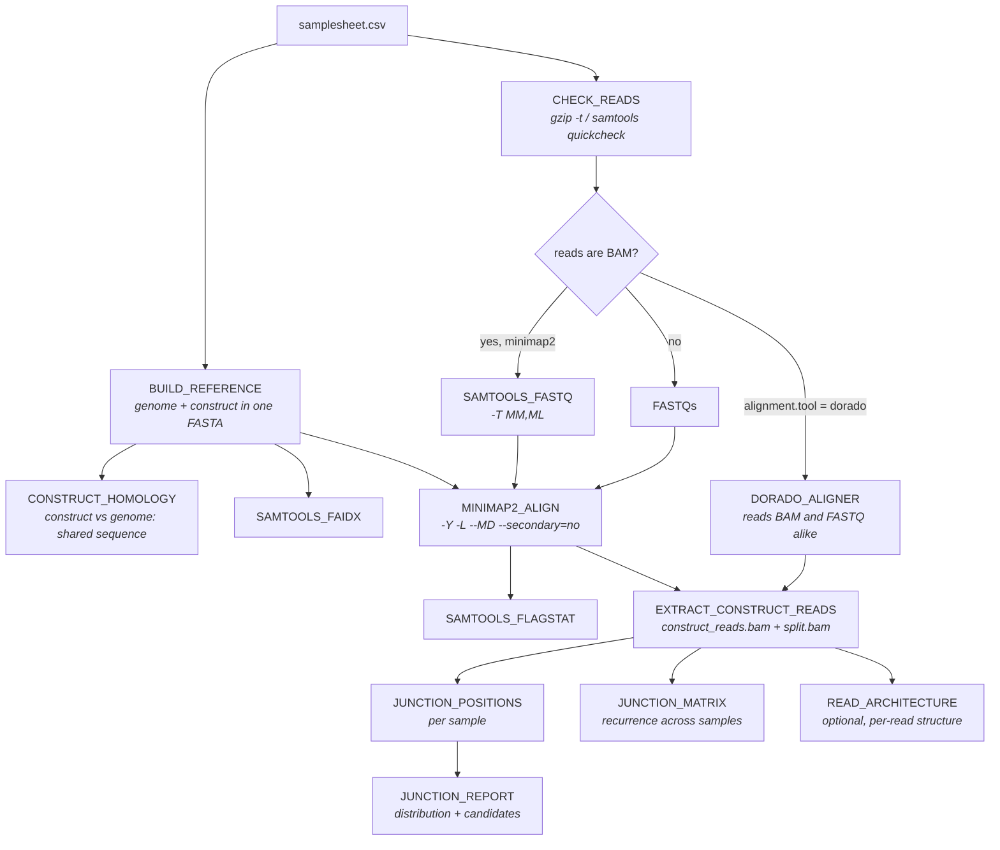

# nf-linear-replicon

Finds where a linear replicon construct has integrated into a host genome, from
Nanopore reads. It is the `wei_linear_replicon` cluster pipeline
(`prep_ref` → `align` → `analyse`) rewritten as Nextflow, with the same logic,
the same thresholds and the same output files.

**The whole idea in one line:** align each sample against the genome **and** the
construct *together*. A read that crosses an integration junction then gets a
primary alignment on one sequence and a supplementary alignment on the other,
and minimap2 records the pairing in the `SA` tag. Everything below is read off
those pairs.

---

## What the pipeline does



| Stage | What it is for |
|---|---|
| `BUILD_REFERENCE` | one combined genome+construct FASTA per pair, and the name of the construct contig |
| `CONSTRUCT_HOMOLOGY` | every alignment between construct and genome. Shared sequence makes fake junctions at a **fixed construct coordinate** in every sample — read this before believing a result |
| `CHECK_READS` | a truncated `.fastq.gz` desynchronises the SAM stream and kills samtools hours later with a misleading error. Caught up front instead |
| `MINIMAP2_ALIGN` | `-Y` keeps the split pieces soft-clipped, so the sequence either side of a junction stays in the record |
| `EXTRACT_CONSTRUCT_READS` | the two small BAMs: every alignment of every read touching the construct, and of those, the reads broken across two places |
| `JUNCTION_POSITIONS` | per sample: every genome position where the construct joins the genome, with read support |
| `JUNCTION_REPORT` | those tables pooled: the distribution table and the shortlist |
| `JUNCTION_MATRIX` | the same junctions pooled and clustered across samples — recurrence is the strongest evidence there is |
| `READ_ARCHITECTURE` | optional: per-read segment maps, independent-molecule counts, construct–construct junctions |

---

## Run it

```bash
# on the cluster
nextflow run EIT-GBI/nf-linear-replicon -r v1.0.0 \
    -profile cluster -params-file params.cluster.yaml

# on a laptop, with Docker
nextflow run EIT-GBI/nf-linear-replicon -profile docker \
    --samplesheet samplesheet.csv --reference_dir ref --outdir results

# the bundled example, with minimap2/samtools/python3 from $PATH
nextflow run . -profile test,local
```

`-profile local` runs without any container, using the tools on your `$PATH`.
`-profile docker` / `-profile apptainer` use the pinned module images.

### The samplesheet

```csv
sample,readset,barcode,reference_genome,additional_reference,fastq_path
LWm010,20260928,barcode01,CHOWT_genome,LP247_maxi,/path/to/run/fastq_pass/barcode01
LWm010,20261023,barcode04,CHOWT_genome,LP247_maxi,/path/to/other_run/bam_pass/barcode04
CONTROL,20260928,barcode09,CHOWT_genome,LP247_maxi,/path/to/run/fastq_pass/barcode09
```

| column | |
|---|---|
| `sample` | the clone. Repeats across readsets on purpose |
| `readset`, `barcode` | optional, but outputs are keyed on `sample__readset__barcode`, so without them two libraries of one clone collide |
| `reference_genome`, `additional_reference` | file names under `--reference_dir`. The extension may be left off: `.fa`, `.fasta`, `.fna` and their `.gz` forms are all tried |
| `fastq_path` | a **folder**, searched recursively. A relative path is taken relative to the samplesheet |

**`fastq_path` may point at `bam_pass` instead of `fastq_pass`.** Dorado writes
unaligned BAM by default now. The column name does not change: FASTQs are looked
for first and `*.bam` is the fallback, and FASTQ wins if a folder holds both.
On the BAM route `samtools fastq -T MM,ML` plus minimap2 `-y` carry the
modified-base tags through, and `samtools quickcheck` replaces the `gzip -t`
precheck.

### Choosing the aligner

`params.alignment.tool` is `minimap2` (default) or `dorado`.

minimap2 is the tested path, and the one the flags are written for: `-Y`,
`--secondary=no`, `--MD`. Unaligned BAM is converted by `SAMTOOLS_FASTQ` first.

`dorado aligner` reads FASTQ and unaligned BAM alike, so that conversion step
disappears — but it takes **one read file per sample**, and an ONT
`fastq_pass`/`bam_pass` folder usually holds many, so the pipeline stops with a
clear error rather than aligning a fraction of the reads. It also does not
expose the minimap2 flags above. Use it when a sample is one BAM; otherwise stay
on the default. (The module also carries its own `publishDir`, so its BAMs
appear under `params.outdir/aligned` whatever `-output-dir` says.)

---

## Reading the result

In `<outdir>/results/`:

| file | what it shows |
|---|---|
| `junction_positions_distribution.csv` | how many positions have 1 read, 2 reads, … per sample |
| `junction_positions_candidates.csv` | every position, best-supported first |
| `junction_positions.csv` | the same, unsorted |
| `junction_matrix.csv` | one row per locus, one column per sample |
| `junction_summary.csv` | junction reads as a fraction of construct reads |
| `architecture/<id>.architecture.txt` | optional: per-read structure and the loci it implies |

**Start with the distribution table.** Accidental joins made during library prep
land in random places, so they give one read per position. A real integration is
crossed by several reads at the same place. Comparing a control against a sample
there is how you pick the cutoff — not a fixed threshold.

A real integration site has several reads at the same position, long alignments
on both sides (500 bp each is already enforced), recurs in repeat libraries of
the same clone (`junction_matrix.csv`), and is **absent from your controls**.
Any position that also appears in a no-construct or spike-in control is an
artifact, however good it looks.

Two traps:

- Identical per-read lengths at one position (`6152;6152` in the `*_each`
  columns) usually mean the same molecule was sequenced twice — less
  independent support than the read count suggests. The optional architecture
  report counts distinct shear points for exactly this reason.
- `construct_from` equal to `construct_to` is **not** a 1 bp match. It means
  every read broke at the same construct base, which is a good sign. Use
  `construct_bp` for the length.

Then open `subset/*.split.bam` in IGV at the shortlisted positions. Those files
are small; download them rather than the full BAMs.

Also worth a look before interpreting anything: `ref/*.homology.txt` lists every
alignment between construct and genome. Shared sequence produces fake junctions
at a *fixed construct coordinate* in every sample.

### The rest of the output

```
<outdir>/
├── ref/        combined FASTA + .fai, construct-vs-genome homology (PAF + readable)
├── aligned/    <id>.sorted.bam + .bai
├── qc/
│   ├── flagstat/   alignment metrics
│   └── contigs/    which non-construct contigs the split reads hit
├── subset/     <id>.construct_reads.bam, <id>.split.bam (+ indexes), <id>.names.txt
└── results/    the tables above
```

---

## Tuning

Everything is a parameter; the defaults are the cluster pipeline's.

| param | default | |
|---|---|---|
| `junction.min_genome_bp` / `min_construct_bp` | 500 | the main false-positive filter: reads joined by accident, and the short stretches the construct shares with the genome, both leave one **short** side |
| `junction.group_within` | 100 | Nanopore breakpoints wobble a few bases |
| `junction.min_mapping_quality` | 60 | below this is repetitive sequence, not trustworthy |
| `junction.min_reads_to_shortlist` | 1 | 1 keeps the single-read background you judge against |
| `matrix.cluster_tolerance` | 2000 | breakpoints within this distance are one locus |
| `matrix.min_total_reads` | 2 | drop clusters with fewer reads than this in total |
| `host_contig_prefixes` | `['NC_', 'NW_']` | how the construct contig is told apart from the host's |
| `architecture.enabled` | false | the per-read architecture report |

`host_contig_prefixes` matters more than it looks: everything downstream
identifies the construct as *the contig that is not a host accession*. A
construct whose FASTA header starts with one of these is a hard error in
`BUILD_REFERENCE`, because it would otherwise be taken for a chromosome and
silently yield zero junctions.

---

## Testing

```bash
nf-test test                      # laptop: tools from $PATH
nf-test test --profile test,docker
nextflow run . -profile test,local
```

The test data is in `assets/test-data`, built from a fixed seed by
`scripts/make_test_data.py`, and **its truth is known**: a 75 kb three-contig
genome, a 6 kb construct, one integration planted at `NC_900001.1:20000` joined
at construct base 1200, crossed by 6 reads in one library of `SAMPLE1` and 5 in
the other, absent from `CONTROL`, with one-off chimeras scattered through every
sample as background. `assets/test-data/truth.json` records it.

So the tests assert that the pipeline **found the integration that was
planted** — not that a checksum did not move. They also check that the control
stays clean, that raising `min_construct_bp` above the planted junction removes
it (the filter is really being applied), that unaligned BAM input gives the same
answer as FASTQ, and that the dorado route skips the conversion step.

---

## Layout

```
main.nf                     the whole workflow, top to bottom
nextflow.config             parameters, containers, resources, profiles
modules/samtools|minimap2|dorado   nf-mod-* git submodules (do not edit)
modules/local/              the steps with no module of their own
scripts/make_test_data.py   rebuilds assets/test-data from a fixed seed
tests/main.nf.test          nf-test suite
```

`modules/local/*` are ports of the cluster shell scripts, one process each, with
their awk kept intact so the two can be compared line by line.

## What is not here

`replicon_reads.py` and `plots.py` from the cluster repo are exploratory tools —
whole-read re-mapping, palindrome and telomere-tract analysis, figures — run by
hand on `subset/` once you have a shortlist. They are not part of the pipeline
and are not bundled; use them from the `wei_linear_replicon` repo against the
published `subset/` folder.
